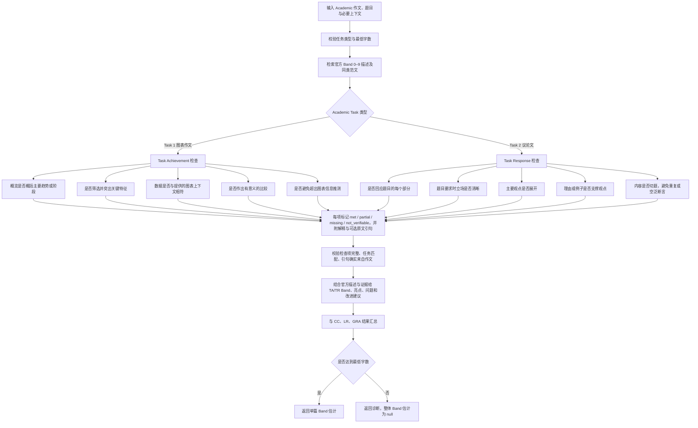

# Academic 任务完成度与论证质量检查

本阶段在 Task Achievement / Task Response 的评分结果中加入结构化检查证据。它帮助模型按官方维度审阅作文，不新增独立评分标准，也不让检查清单自动换算成 Band。

## 检查项解释

Task 1 检查 overview、关键特征、数据准确性、比较和是否超出图表范围。数据核对只依据请求提供的 `chart_context`；如果上下文不完整，模型应说明无法确认，不应补造数据。

Task 2 检查题目各部分是否实际得到回答、立场（在题目要求时）是否明确、观点有没有解释展开、支撑是否相关，以及是否偏题或重复。提纲式预告（例如“我将讨论双方”）本身不能算作已经完成论证。

每个检查项记录 `met`、`partial`、`missing` 或 `not_verifiable`，并提供解释；如有原文证据则附引句。程序会验证引句是否来自作文，并将模型用省略号缩写的引句还原为作文中的连续原文。检查结果为评分提供可审阅的理由，不会单独触发固定扣分，也不会替代 Band 描述。Task 1 数据准确性依赖用户提供的图表文字/数据上下文；信息不足时标为无法核验，系统不会自行读取图表图片或推造数值。

低于 Academic Task 1 的 150 词或 Task 2 的 250 词时，系统仍可做这些诊断，但继续将 `essay_band_estimate` 设为 `null`，不把诊断包装成可靠总分。
